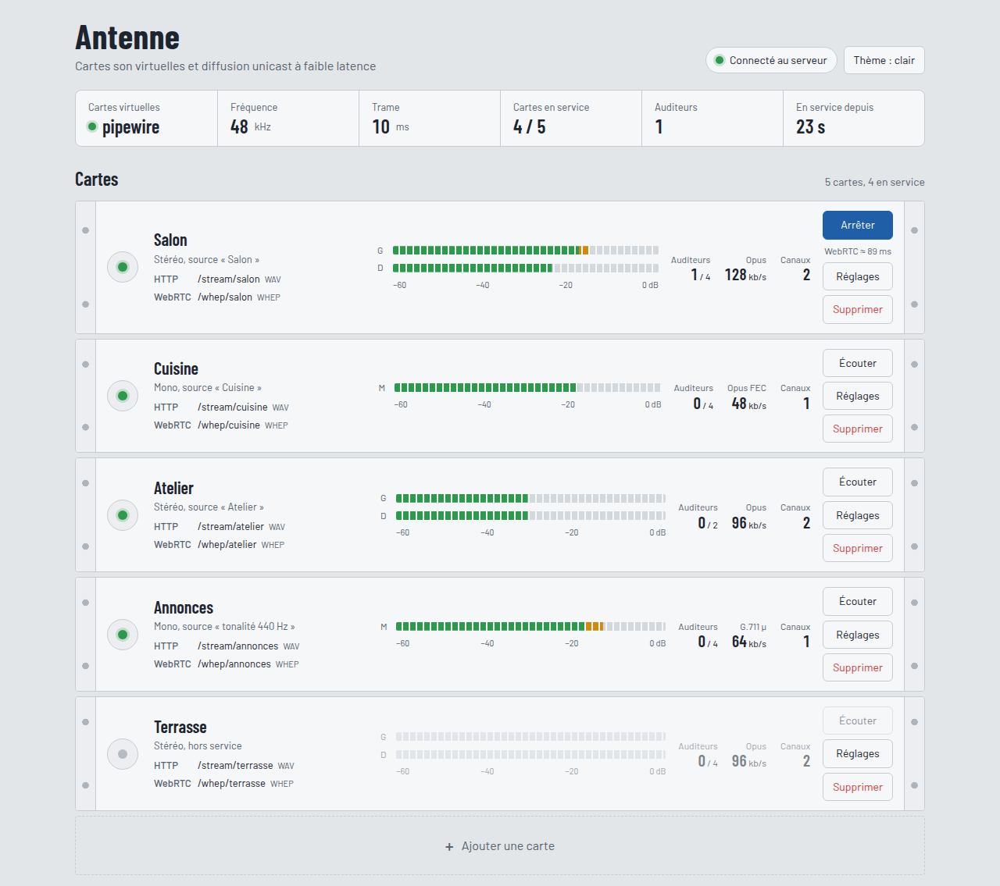
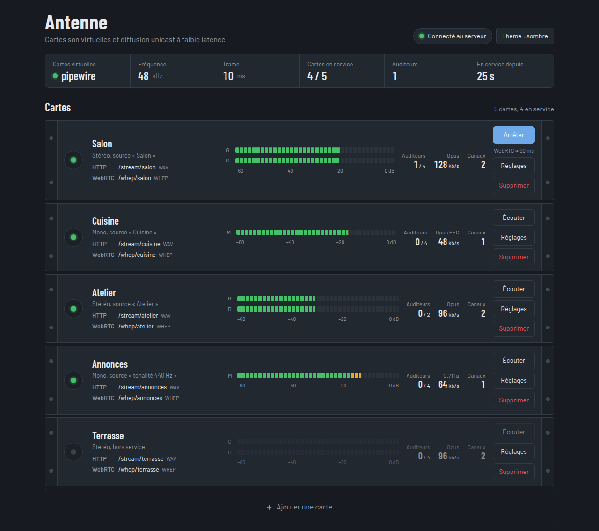
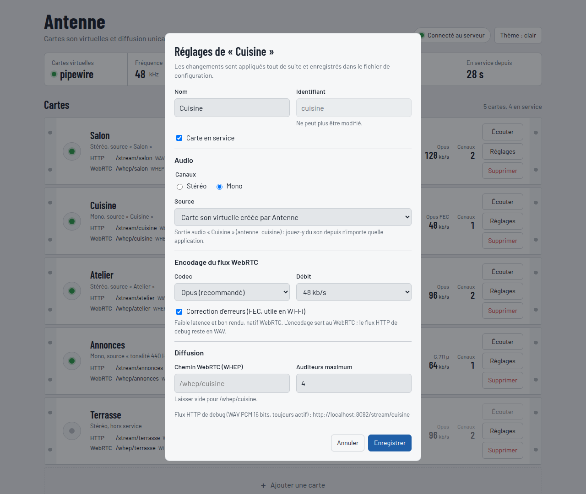
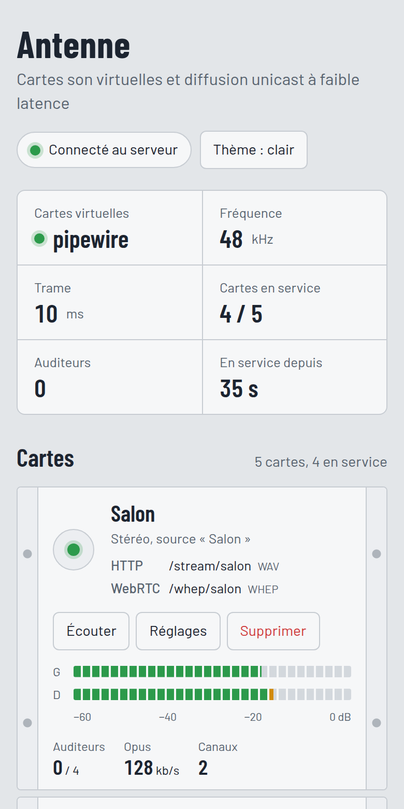

# Antenne

**Cartes son virtuelles et diffusion audio à faible latence vers des ESP32.**
Un seul programme, écrit en Rust, pour Linux, macOS et Windows, piloté depuis une page web.

[](https://github.com/julienrat/antenne/actions/workflows/ci.yml)



```
Applications ──► Salon    ──┐                      ┌──► ESP32 salon
                 Cuisine  ──┼──► Antenne ──Wi-Fi───┼──► ESP32 cuisine
                 Atelier  ──┘   capture, encodage, └──► navigateur
                                WebRTC (WHEP)
```

Antenne crée **une sortie audio par pièce** (« Salon », « Cuisine »…). Toute application
peut y jouer du son, comme vers une vraie carte son. Antenne capture chaque sortie, l'encode
et la diffuse **en unicast** à chaque client qui s'y abonne : un ESP32 relié à une enceinte,
ou un simple navigateur.

## Ce qu'il sait faire

- **Plusieurs cartes son virtuelles**, créées et supprimées automatiquement sous Linux
  (PipeWire). Sous macOS et Windows, elles s'appuient sur un pilote de bouclage
  (BlackHole, VB-CABLE).
- **Une adresse WebRTC par carte** (`/whep/salon`), en mono ou en stéréo, en Opus ou en G.711.
  Le WebRTC est mesuré à **35–55 ms** de latence dans un navigateur en réseau local.
- **Interface web** : état des cartes, vu-mètres, écoute directe, réglages et ajout de cartes,
  bouton pour quitter Antenne quand il tourne en arrière-plan.
  Les changements s'appliquent **sans redémarrer** et sont enregistrés dans le fichier de
  configuration.
- **Autres sources** possibles pour une carte : une entrée existante (micro, interface audio)
  ou une tonalité de test.
- **Flux HTTP WAV** par carte pour déboguer avec VLC ou ffplay.

| Thème sombre | Réglages d'une carte | Sur téléphone |
|:---:|:---:|:---:|
|  |  |  |

Le guide complet de l'interface est dans [docs/06-interface.md](docs/06-interface.md).

## Installer

### Linux : AppImage

Télécharger `Antenne-<version>-x86_64.AppImage`, la rendre exécutable, puis la lancer :

```sh
chmod +x Antenne-*-x86_64.AppImage
./Antenne-*-x86_64.AppImage
```

Au premier lancement, la configuration est créée dans `~/.config/antenne/antenne.toml` et
l'interface s'ouvre dans le navigateur. Les cartes virtuelles demandent `pactl`, fourni par
`pipewire-pulse` ou `pulseaudio-utils`.

### macOS : DMG

Ouvrir `Antenne-<version>-macos-universal.dmg` et glisser **Antenne.app** dans Applications.
Au premier lancement, faire **clic droit > Ouvrir** : l'application n'est pas notarisée par
Apple. Pour les cartes virtuelles, installer [BlackHole 16ch](https://existential.audio/blackhole/).
Le fichier `LISEZMOI.txt` du DMG donne le détail.

Les paquets sont produits par le workflow [Paquets](.github/workflows/release.yml) :
lancement manuel depuis l'onglet *Actions*, ou automatique sur une étiquette `v*`.

### Depuis les sources

```sh
bash scripts/setup-linux.sh        # ou setup-macos.sh, ou setup-windows.ps1
cargo run --release -p antenne -- --config config/antenne.example.toml run
```

## Premiers pas

1. **Lancer Antenne**, puis ouvrir l'interface : <http://localhost:8080/>.
2. **Jouer du son** vers une carte : choisir « Antenne Carte 1 » comme sortie dans les réglages
   son du système ou dans une application. Son vu-mètre doit bouger.
3. **Écouter** : bouton « Écouter » de la carte, dans l'interface. Le navigateur se connecte en
   WebRTC, exactement comme le fera un ESP32.
4. **Brancher un client** : un client WHEP envoie son offre SDP sur l'adresse WebRTC de la
   carte (`POST http://<pc>:8080/whep/carte1`). Le protocole est décrit dans
   [docs/04-esp32.md](docs/04-esp32.md).

Pour déboguer sans WebRTC :

```sh
ffplay -nodisp -fflags nobuffer -flags low_delay http://localhost:8080/stream/carte1
vlc --network-caching=50 http://localhost:8080/stream/carte1
```

## Configuration

Un fichier TOML ; l'exemple commenté est [config/antenne.example.toml](config/antenne.example.toml).
L'interface web le réécrit quand on change un réglage, en gardant l'ancienne version en `.bak`.

```toml
[server]
bind = "0.0.0.0:8080"            # adresse de l'interface, de l'API et du WebRTC

[[card]]
id = "salon"                     # sert dans les adresses : /whep/salon, /stream/salon
name = "Salon"                   # nom de la sortie audio côté système
channels = "stereo"              # ou "mono"
source = { kind = "virtual" }    # ou { kind = "device", device = "…" } / { kind = "tone" }
encoding = { codec = "opus", bitrate_kbps = 96 }   # ou g711u, g711a, pcm16
max_listeners = 4
```

Pour vérifier un fichier : `antenne --config antenne.toml check`. Pour lister les entrées
audio : `antenne devices`.

## API

| Route | Rôle |
|-------|------|
| `GET /` | interface web |
| `GET /api/cards` · `POST /api/cards` | liste des cartes · ajout |
| `PUT /api/cards/{id}` · `DELETE /api/cards/{id}` | modification · suppression |
| `GET /api/status` · `GET /api/levels` · `GET /api/devices` | état du serveur · vu-mètres · entrées audio |
| `POST /api/shutdown` | arrête Antenne (bouton « Quitter » de l'interface) |
| `POST <path>` · `DELETE <path>/<session>` | WebRTC (WHEP) : ouverture · fermeture de session |
| `GET /stream/{id}` | flux WAV de debug |

⚠️ L'interface et l'API n'ont **pas d'authentification** : n'importe qui sur le réseau local
peut modifier les cartes ou arrêter Antenne. Pour limiter l'accès à la machine elle-même, mettre
`bind = "127.0.0.1:8080"`.

## Développement

```sh
cargo build                  # binaire `antenne` (Opus inclus)
cargo test --workspace
cargo lint                   # clippy strict, comme la CI
cargo fmt --all
cargo dev                    # lance avec la config d'exemple
packaging/linux/build-appimage.sh   # dist/Antenne-<v>-x86_64.AppImage
packaging/macos/build-dmg.sh        # sur un Mac : DMG universel
```

```
crates/
  antenne-core/     configuration TOML et validation, types communs
  antenne-audio/    capture (cpal), cartes virtuelles (PipeWire, loopback), tonalité
  antenne-codec/    PCM16, G.711, Opus
  antenne-net/      serveur HTTP : interface, API, WebRTC (str0m), flux WAV
  antenne/          binaire, gestion des cartes à chaud
config/             configuration d'exemple
packaging/          AppImage, DMG, icône
docs/               documentation
```

Le contexte pour Claude Code est dans [CLAUDE.md](CLAUDE.md). La CI vérifie le format,
clippy et les tests sur Linux, macOS et Windows, ainsi que la version minimale de Rust (1.89, imposée par str0m).

## Documentation

1. [Cahier des charges](docs/01-cahier-des-charges.md)
2. [Architecture](docs/02-architecture.md) : crates, threads, décisions
3. [Plateformes](docs/03-plateformes.md) : cartes virtuelles et paquets par OS
4. [Clients ESP32](docs/04-esp32.md) : protocole WHEP, codecs
5. [Roadmap](docs/05-roadmap.md)
6. [Interface web](docs/06-interface.md) : guide d'utilisation

## État

Jalons 0 à 3 terminés : socle, Linux de bout en bout, WebRTC, interface web, paquets.
Prochaines étapes : client ESP32 (jalon 4), validation macOS / Windows (jalon 5),
robustesse (jalon 6). Le détail est dans la [roadmap](docs/05-roadmap.md).

## Licence

À définir.
