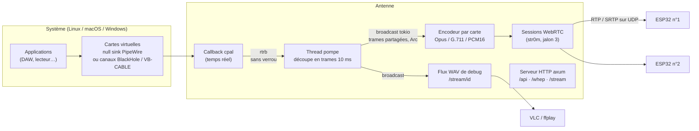

# 02 — Architecture

## Vue d'ensemble

Une carte = une source audio = un canal `broadcast` = N auditeurs (bornés).

## Découpage en crates

| Crate | Rôle | Dépend de |
|-------|------|-----------|
| `antenne-core` | Configuration TOML + validation, `AudioFrame`. **Aucune** dépendance audio/réseau. | serde, toml |
| `antenne-audio` | Capture cpal, générateur de tonalité, backends de cartes virtuelles (PipeWire, loopback). | core, cpal, rtrb |
| `antenne-codec` | Trait `Encoder` ; PCM16, G.711, Opus (feature `opus`). | core, (opus) |
| `antenne-net` | Serveur axum : API, flux WAV, signalisation WHEP (WebRTC à venir). | core, codec, axum, tokio |
| `antenne` | Binaire : CLI, orchestration, arrêt propre. | toutes |

Règle : les dépendances vont toujours **vers** `antenne-core`, jamais l'inverse ; `antenne-audio`
et `antenne-net` ne se connaissent pas (c'est `antenne` qui les relie).

## Modèle de threads

| Contexte | Contraintes |
|----------|-------------|
| **Callback cpal** (thread audio de l'OS) | Temps réel strict : **pas** d'allocation, de verrou, de log, d'appel système. Copie les canaux utiles dans un ring buffer `rtrb`, compte les débordements. |
| **Thread pompe** (un par carte) | Vide le ring buffer, assemble des trames de `frame_ms`, publie sur le `broadcast`. Possède le `cpal::Stream` (qui n'est pas `Send` partout). |
| **Runtime tokio** | HTTP, signalisation, sessions WebRTC, encodage. Un auditeur lent est « en retard » (`Lagged`) et saute des trames, sans jamais bloquer la capture. |

## Données

- `AudioFrame` : PCM `f32` entrelacé, `Arc<[f32]>` (diffusion sans copie), numéro de séquence,
  instant de capture (mesure de latence).
- Fréquence interne unique : `audio.sample_rate` (48 kHz par défaut, natif Opus). Le G.711
  sous-échantillonne à 8 kHz dans son encodeur.

## Gestion des erreurs

- Bibliothèques : `thiserror` (types d'erreurs explicites) ou `anyhow` avec contexte.
- Binaire : `anyhow`, messages en français, une carte en échec est marquée `failed` dans
  `/api/cards` et n'empêche pas les autres de démarrer.
- Aucun `unwrap()` / `expect()` hors tests (lint clippy activé).

## Décisions techniques

| # | Décision | Pourquoi | Statut |
|---|----------|----------|--------|
| D1 | **Rust stable, édition 2024, MSRV 1.89** (minimum de str0m) | sûreté mémoire + perf temps réel, binaire unique | acté |
| D2 | **cpal 0.18** pour la capture | seule couche Rust mûre couvrant CoreAudio, WASAPI, ALSA, PipeWire natif | acté |
| D3 | **PipeWire null sink** par carte sous Linux (via `pactl` en v1) | création / suppression dynamique, sans pilote | proposé |
| D4 | **Pilote de bouclage existant** sous macOS / Windows, découpé en canaux | un pilote maison = signature / notarisation, hors v1 | proposé |
| D5 | **WebRTC via `str0m`** (sans-IO) | contrôle fin des paquets et de la latence, pas de runtime imposé ; backend crypto retenu : **rust-crypto** (100 % Rust, ni cmake ni NASM) | acté |
| D6 | **Signalisation WHEP** (POST d'offre SDP sur le chemin de la carte) | standard simple, symétrique de WHIP, un chemin = une carte | acté |
| D7 | **Opus 10 ms, `LowDelay`** par défaut ; G.711 pour les ESP32 modestes | compromis latence / qualité / CPU | proposé |
| D8 | **axum + tokio** pour HTTP | écosystème standard, simple à tester | acté |
| D9 | Flux **WAV HTTP** de debug | tester la chaîne sans client WebRTC | acté |
| D10 | **Interface web de supervision** servie sur `GET /` : une page HTML intégrée au binaire (`include_str!`), qui interroge `/api/cards`, `/api/status` et `/api/levels` (vu-mètres, tâche tokio par carte abonnée au `broadcast`) | rien à installer, multiplateforme ; le polling HTTP suffit en local, WebSocket si besoin plus tard | acté |
| D11 | **Cartes modifiables à chaud** : `CardManager` (crate `antenne`) possède l'audio et publie une liste partagée `Arc<RwLock<Vec<Arc<CardChannel>>>>` lue par `antenne-net` ; les modifications passent par le trait `CardControl` (appelé en `spawn_blocking`). Chaque changement est validé sur la config complète, écrit dans le TOML (`toml_edit`, commentaires hors cartes conservés, ancienne version en `.bak`), puis appliqué : redémarrage de la source seulement si canaux, source, mise en service ou nom d'une carte virtuelle changent ; backend positionnel (`loopback`) → toutes les cartes recréées. Chemins WHEP résolus dans le `fallback` du routeur | `antenne-net` reste sans dépendance audio ; un flux en cours n'est coupé que si c'est nécessaire | acté |
| D12 | **Paquets** : AppImage (lanceur `AppRun`, config dans `~/.config/antenne/`, libopus lié statiquement, libpipewire / libasound pris sur l'hôte) et DMG universel (`lipo` arm64 + x86_64, `Antenne.app` qui ouvre le serveur dans le Terminal, config dans `~/Library/Application Support/Antenne/`, signature ad hoc). Construits par `packaging/*` et la CI `release.yml` (Ubuntu 22.04 pour la glibc, macos-14) | serveur sans fenêtre : l'interface est la page web ; libpipewire doit correspondre au démon PipeWire de l'hôte, on ne l'embarque pas | proposé |
| D13 | **Session WebRTC = une tâche tokio** avec son `Rtc` str0m, **son socket UDP** (port éphémère), son encodeur et un abonnement au `broadcast` de la carte ; un seul candidat hôte (IP `server.public_ip` ou interface vers le client) ; seul le codec de la carte est négocié | le plus simple et robuste en LAN ; un encodeur par auditeur reste négligeable pour quelques ESP32 ; socket partagé / encodage mutualisé si besoin plus tard | acté |

Toute nouvelle décision structurante s'ajoute à ce tableau (avec sa date si utile).
