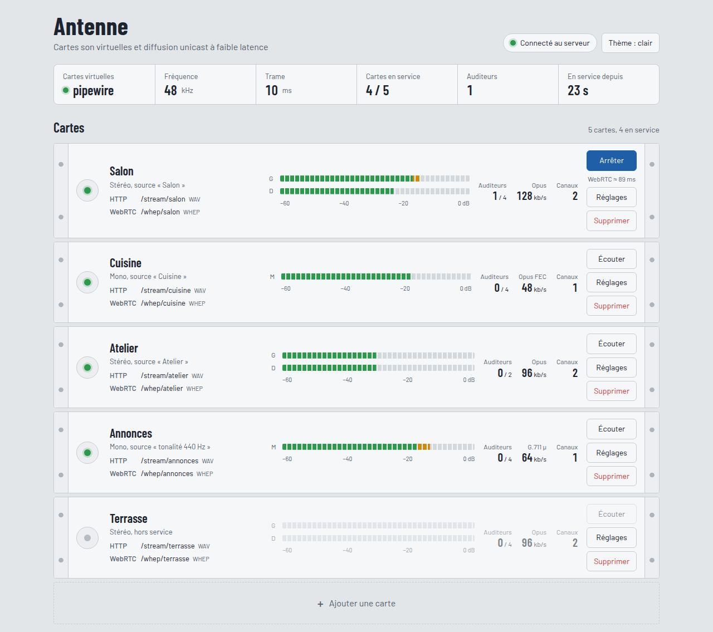
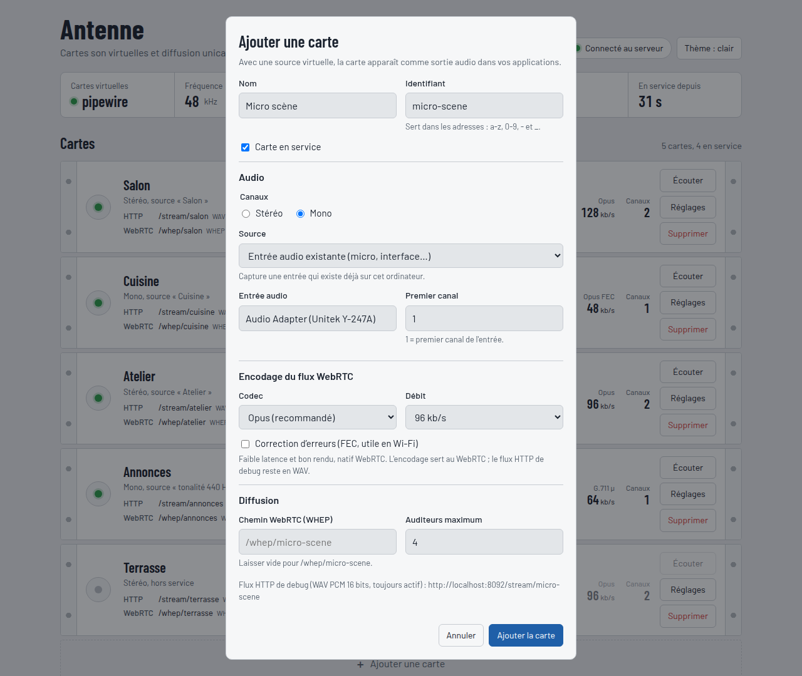
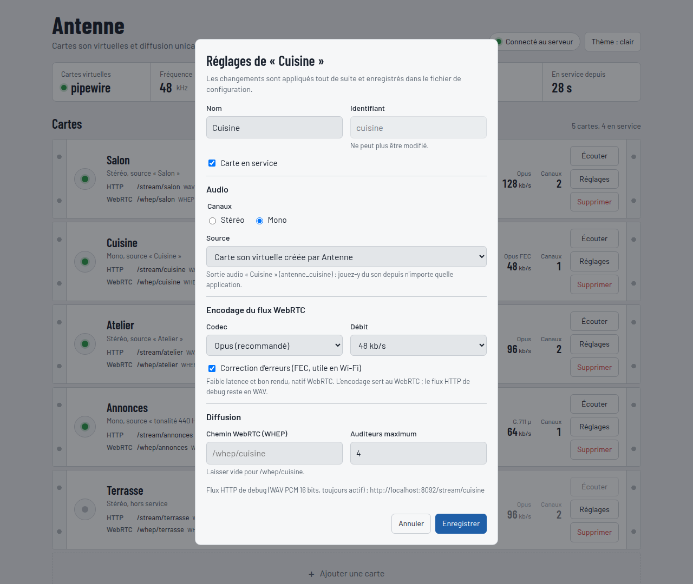

# 06 — Interface web

L'interface d'Antenne est une page web servie par Antenne lui-même. Il n'y a rien à installer :
elle s'ouvre dans n'importe quel navigateur récent, sur l'ordinateur qui fait tourner Antenne
ou depuis un autre appareil du réseau (téléphone, tablette).

## Ouvrir l'interface

| Situation | Adresse |
|-----------|---------|
| Sur l'ordinateur d'Antenne | <http://localhost:8080/> |
| Depuis un autre appareil du réseau | `http://<adresse-IP-de-l'ordinateur>:8080/` |

Le port est celui de `bind` dans la section `[server]` du fichier de configuration. L'AppImage
et l'application macOS ouvrent l'interface toutes seules au démarrage.

La pastille en haut à droite indique la connexion :
- **verte, « Connecté au serveur »** : tout va bien ;
- **rouge, « Serveur injoignable »** : Antenne est arrêté ou le réseau est coupé. La page
  réessaie toute seule chaque seconde.

Le bouton **Thème** fait défiler *auto* (suit le système), *clair* et *sombre*. Le choix est
mémorisé dans le navigateur.

## Quitter Antenne

Le bouton rouge **Quitter**, en haut à droite, arrête Antenne : utile quand il tourne en
arrière-plan sans fenêtre. Cliquer une fois : le bouton devient **« Confirmer l'arrêt ? »**,
cliquer à nouveau dans les 3 secondes pour confirmer.

L'arrêt est le même qu'un Ctrl+C dans le terminal : les sorties audio créées par Antenne sont
supprimées, les auditeurs (ESP32, navigateurs, VLC) sont déconnectés, puis le programme se
termine. La page affiche alors « Antenne est arrêté » et ne cherche plus à se reconnecter.
Pour relancer Antenne, rouvrir l'application (AppImage, Antenne.app) ou relancer la commande.

## Le bandeau d'état

| Case | Signification |
|------|---------------|
| **Cartes virtuelles** | Mécanisme utilisé pour créer les sorties audio : `pipewire` (Linux), `loopback` (macOS, Windows), ou *aucun* si indisponible. |
| **Fréquence** | Fréquence d'échantillonnage interne (48 kHz par défaut). |
| **Trame** | Durée d'un paquet audio (10 ms par défaut) : c'est le pas de base de la latence. |
| **Cartes en service** | Cartes qui diffusent / cartes déclarées. |
| **Auditeurs** | Clients connectés en ce moment, toutes cartes confondues (ESP32, navigateurs, VLC…). |
| **En service depuis** | Temps écoulé depuis le démarrage d'Antenne. |

## Les cartes

Chaque carte est une « baie » du rack. De gauche à droite :

- **Voyant marche / arrêt** : vert, la carte diffuse ; gris, elle est hors service ; rouge, elle
  est en échec, avec le message d'erreur affiché sous son nom. **Cliquer sur le voyant** met
  la carte en service ou hors service.
- **Nom, canaux et source** : par exemple « Stéréo, source « Salon » ». Pour une carte
  virtuelle, la source est la sortie audio que crée Antenne.
- **Adresses** : cliquer sur une adresse la copie dans le presse-papiers.
  - **HTTP** `/stream/<id>` : flux WAV de debug (VLC, ffplay) ;
  - **WebRTC** `/whep/<id>` : l'adresse à donner aux ESP32.
- **Vu-mètres** : niveau crête de chaque canal (G et D en stéréo, M en mono), sur une
  échelle de −60 à 0 dB. **Vert** jusqu'à −18 dB, **orange** jusqu'à −6 dB, **rouge** au-delà :
  si le rouge s'allume souvent, baisser le volume de l'application qui joue.
- **Auditeurs** : connectés / maximum autorisé pour cette carte.
- **Codec et débit** : encodage du flux WebRTC (Opus, G.711 µ ou A).
- **Canaux** : 1 (mono) ou 2 (stéréo).

### Écouter une carte

Le bouton **Écouter** joue la carte dans le navigateur. **Arrêter** coupe l'écoute.

- Pour une carte en Opus ou en G.711, le navigateur se connecte **en WebRTC**, exactement comme
  un ESP32. C'est le bon moyen de vérifier une carte avant d'y brancher des enceintes. La
  latence mesurée s'affiche sous le bouton, par exemple « WebRTC ≈ 53 ms ».
- Pour une carte en PCM 16 bits (sans WebRTC), il lit le flux WAV avec un tampon court
  (environ 50 à 150 ms).
- L'écoute **compte comme un auditeur** : sur une carte pleine, le bouton échoue avec
  « nombre maximal d'auditeurs atteint ».
- Une seule carte s'écoute à la fois.

### Ajouter une carte

Le cadre en pointillés **« + Ajouter une carte »**, sous les cartes, ouvre la fenêtre de
réglages vide. L'identifiant est déduit du nom (« Micro scène » donne `micro-scene`) et peut
être corrigé avant l'enregistrement.

### Supprimer une carte

**Supprimer**, puis **Confirmer ?** dans les 3 secondes. La sortie audio disparaît du système et
les auditeurs sont déconnectés. La dernière carte ne peut pas être supprimée : la configuration
en exige au moins une.

## Les réglages d'une carte

Le bouton **Réglages** ouvre la fenêtre de la carte. **Enregistrer** applique tout de suite :
il n'y a pas besoin de redémarrer Antenne.

| Réglage | Rôle | Remarques |
|---------|------|-----------|
| **Nom** | Nom affiché, et nom de la sortie audio côté système pour une carte virtuelle | |
| **Identifiant** | Sert dans les adresses (`/whep/<id>`, `/stream/<id>`) | a-z, 0-9, `-` et `_`, 32 caractères au plus. **Ne peut plus être modifié** après la création. |
| **Carte en service** | Décoché, la carte est déclarée mais ne diffuse pas | Même effet que le voyant. |
| **Canaux** | Stéréo ou mono | G.711 impose le mono : la case Stéréo est alors grisée. |
| **Source** | *Carte son virtuelle* : une sortie audio créée par Antenne ; *Entrée audio existante* : un micro, une interface audio ou un pilote de bouclage ; *Tonalité de test* : une sinusoïde | Pour une entrée existante, choisir dans la liste proposée et indiquer le **premier canal** (1 = premier). |
| **Codec** | *Opus* : recommandé, bon rendu et faible latence ; *G.711 µ-law / A-law* : mono 8 kHz, très léger, pour les petits ESP32 ; *PCM 16 bits* : non compressé, sans WebRTC | Le codec ne s'applique qu'au WebRTC. Le flux HTTP de debug reste toujours en WAV. |
| **Débit** (Opus) | De 16 à 256 kb/s | 48 kb/s suffit pour de la voix, 96 à 128 kb/s pour de la musique. |
| **Correction d'erreurs** (Opus) | Ajoute de la redondance (FEC) | Utile en Wi-Fi chargé ; augmente un peu le débit. |
| **Chemin WebRTC** | Adresse WHEP de la carte | Vide = `/whep/<id>`. Ne peut pas commencer par `/api`, `/stream` ni `/health`. |
| **Auditeurs maximum** | Nombre de clients simultanés | Les auditeurs déjà connectés ne sont pas coupés si on baisse la limite. |

### Ce qui coupe le son

Certains changements obligent à **redémarrer la carte** : la fenêtre l'annonce en orange avant
l'enregistrement.

| Changement | Effet |
|------------|-------|
| Canaux, source, mise en service | La carte redémarre : les auditeurs sont déconnectés et doivent se reconnecter (les ESP32 le font d'eux-mêmes s'ils gèrent la reconnexion). |
| Nom d'une carte **virtuelle** | Comme ci-dessus. De plus, la sortie audio est recréée : les applications qui y jouaient repassent sur la sortie par défaut et doivent être redirigées vers la carte. |
| Codec, débit, FEC, chemin, auditeurs maximum | **Aucune coupure.** Les nouveaux réglages valent pour les prochaines connexions. |

### Où les réglages sont enregistrés

Dans le fichier de configuration donné au lancement (`--config`) :

| Installation | Fichier |
|--------------|---------|
| AppImage (Linux) | `~/.config/antenne/antenne.toml` |
| Application macOS | `~/Library/Application Support/Antenne/antenne.toml` |
| Depuis les sources | le fichier passé à `--config` |

La version précédente est gardée à côté, avec l'extension `.bak`. Les commentaires du fichier
sont conservés, sauf ceux écrits à l'intérieur d'une section `[[card]]`.

## Le journal

En bas de page, le journal liste les derniers événements vus par cette page : connexion au
serveur, auditeurs qui arrivent ou partent, écoutes, réglages enregistrés, erreurs. Il est
propre à chaque navigateur et repart de zéro quand on recharge la page. Le journal complet
d'Antenne est dans le terminal qui le fait tourner.

## Sécurité

L'interface n'a **pas de mot de passe** : tout appareil qui peut joindre le port d'Antenne peut
modifier ou supprimer des cartes, et **arrêter Antenne** avec le bouton Quitter. Sur un réseau partagé, limiter l'accès à l'ordinateur
lui-même en mettant `bind = "127.0.0.1:8080"` dans `[server]`. Les ESP32 ne pourront alors
plus se connecter : c'est un réglage pour tester, pas pour diffuser.

## Dépannage

| Symptôme | Cause probable | Que faire |
|----------|----------------|-----------|
| Pastille rouge « Serveur injoignable » | Antenne est arrêté, ou mauvais port | Relancer Antenne ; vérifier `bind`. |
| Antenne s'arrête au démarrage avec « Address already in use » | Un autre programme utilise le port | Changer le port de `bind` (par exemple `0.0.0.0:8090`). |
| Voyant rouge, « aucune entrée audio ne correspond » | Entrée débranchée ou renommée | Choisir une entrée de la liste dans les réglages. |
| Voyant rouge, « aucun backend de cartes virtuelles » | Linux : `pactl` absent ; macOS / Windows : pilote de bouclage absent ou `loopback_device` faux | Installer `pipewire-pulse` (ou `pulseaudio-utils`), BlackHole ou VB-CABLE. |
| Vu-mètre immobile | Aucune application ne joue vers la carte | Choisir la carte comme sortie dans l'application ou dans les réglages son. |
| « Écoute WebRTC impossible : … codec » | Le navigateur ne propose pas le codec de la carte | Passer la carte en Opus. |
| « nombre maximal d'auditeurs atteint » | La carte est pleine | Augmenter *Auditeurs maximum* ou déconnecter un client. |
| Son haché pendant l'écoute | Wi-Fi chargé, ou machine très occupée | Activer la correction d'erreurs (Opus), baisser le débit. |
| Un ESP32 ne se reconnecte pas après un changement | La carte a redémarré | Voir « Ce qui coupe le son » ; redémarrer l'ESP32 si besoin. |
